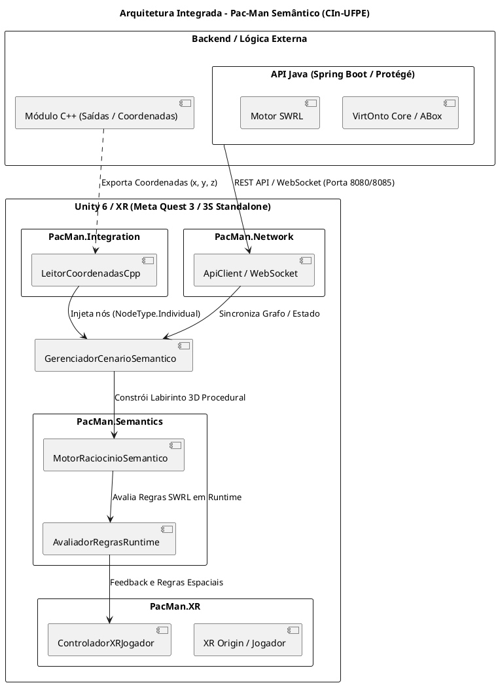

# Pac-Man Semântico (Semantic Pac-Man) 🕹️🧠

[-blue.svg?logo=unity)](https://unity.com/)

[-orange.svg)](https://www.w3.org/standards/semanticweb/ontology)

> ### [🎮 Testar Demonstração Interativa no Browser (WebGL)](https://lanalcantara.github.io/Pac-man-Semantico/)
> Experimente o Pac-Man Semântico diretamente no navegador web: labirinto 3D procedural, movimentação fluida (WASD / Gamepad / Mouse), câmera elevada suave sem tremedeira e avaliação contínua de regras ontológicas SWRL.

---

## 1. Descrição Geral

O **Pac-Man Semântico** é um projeto de pesquisa aplicada desenvolvido no âmbito da disciplina de **Realidade Virtual e Aumentada** do **Centro de Informática da Universidade Federal de Pernambuco (CIn-UFPE)**, sob a orientação do professor **Francisco Paulo Magalhães Simões**. A proposta central do projeto é integrar modelos formais de conhecimento da **Web Semântica (ontologias OWL e regras inferenciais SWRL)** a uma **arquitetura distribuída e imersiva**:

- **Backend em Java (Spring Boot / VirtOnto / Protégé):** Microsserviço REST e WebSocket responsável pelo gerenciamento centralizado do grafo ontológico (TBox e ABox), disponibilizando endpoints para sincronização de nós, arestas e estado lógico com suporte a CORS.
- **Módulo de Coordenadas em C++:** Motor nativo de processamento espacial que exporta coordenadas e pontos de saída no labirinto para enriquecer o grafo semântico.
- **Frontend Imersivo em Unity 6 com Realidade Virtual 360° (XR):** Experiência autônoma (*standalone*) compilada para os óculos **Meta Quest 3** e **Meta Quest 3S** (chipset Qualcomm Snapdragon XR2 Gen 2, ARM64 / OpenXR), além de suporte multiplataforma para PC Windows e WebGL.

---

## 2. Inovações de Câmera, Jogabilidade e Arquitetura (Sprint 1)

- **Arquitetura de Entradas Desacoplada e Zero-GC (`IProvedorEntradaXR`):**
  - Isolamento completo da leitura de periféricos da simulação física e renderização.
  - Estrutura de valor `DadosEntradaJogador` (struct) transmitida com **zero alocações no heap** (0 bytes GC Alloc por frame), eliminando engasgos (*hitches*) e mantendo 90 FPS estáveis para VR.
  - Suporte nativo a **Meta Quest Touch Plus**, **Gamepad Xbox** e **Teclado & Mouse**.
- **Mobilidade Física com Inércia e Wall Sliding (Deslizamento em Paredes):**
  - Aceleração e desaceleração progressivas no `Rigidbody` com `Vector3.MoveTowards`.
  - Algoritmo preditivo de **Wall Sliding** via `Physics.SphereCastNonAlloc`: calcula a normal de contato com paredes e deflete o vetor de movimento ao longo do corredor, garantindo que o Pac-Man contorne esquinas sem prender ou travar.
- **Perspectiva em Primeira Pessoa Imersiva (Escala Humana 1:1) & VR 360°:**
  - Ponto de vista calibrado na altura média dos olhos humanos ($Y = 1.68\text{m}$), conferindo a verdadeira sensação de peso, volume e proporcionalidade espacial.
  - Paredes arquitetônicas de $2.60\text{m}$ erguem-se quase $1\text{m}$ acima da linha de visão com espessura sólida de $1.20\text{m}$, delimitando corredores verossímeis de $\approx 2.20\text{m}$ de largura útil.
  - *Near Clip Plane* fixado em $0.02\text{m}$ ($2\text{cm}$) para evitar qualquer corte de geometria ao encostar em quinas ou paredes.
  - No Meta Quest 3/3S: imersão total com rastreamento 6DoF de cabeça em 360° e locomoção orientada pelo olhar (*Head-oriented locomotion*).
  - No Desktop: rotação livre com Mouse Look (Yaw $360^\circ$ e Pitch $-80^\circ$ a $+80^\circ$).
  - Malhas do avatar `Visual_PacMan` ocultas na inicialização para não obstruir o campo de visão.
- **Colisor Físico Humano & Wall Sliding:**
  - `CapsuleCollider` humano ($1.75\text{m}$ de altura, raio de $0.38\text{m}$, centro em $Y = 0.88\text{m}$).
  - Algoritmo preditivo de deslizamento em paredes com buffers estáticos sem alocações no heap.
- **Feedback Háptico Dual-Controller:**
  - Pulsos táteis diferenciados disparados nos dois controles do headset e gatilhos de Gamepad ao coletar itens, raspar em paredes e colidir com fantasmas.
- **Planejamento de Sprints:**
  - Consulte o [Plano de Sprints Detalhado](file:///C:/Users/testcb/Pac-man-Semantico-Privado/PLANO_SPRINTS.md) para conferir os objetivos e entregáveis das Sprints 1 a 5.

---

## 3. Arquitetura Integrada do Sistema

---

## 4. Instruções de Execução

### Pré-requisitos
- **Unity Hub** e **Unity Editor 6000.6.7f1 (Unity 6)**.
- **Módulo Android Build Support** (com Android SDK/NDK e OpenJDK) para compilar o APK nativo para Meta Quest 3 e Quest 3S.
- **Java JDK 17 ou 21** (para execução opcional do backend Spring Boot / Protégé).

---

### Execução no Unity Editor (Desktop)
1. Abra o projeto no **Unity 6000.6.7f1**.
2. Abra a cena: `Assets/Scenes/DemoWeb/CenaDemoWeb.unity`.
3. Pressione **`Play`** (`▶`).
4. **Controles:**
   - **WASD / Analógico Esquerdo:** Move o Pac-Man relativamente à tela.
   - **Mouse / Analógico Direito:** Gira a câmera em 360°.
   - **Gatilhos RT/LT / Bumpers / Scroll:** Aproxima e afasta o zoom de forma suave.
   - **C / V / Botão Y:** Alterna instantaneamente entre o modo próximo e visão panorâmica.
